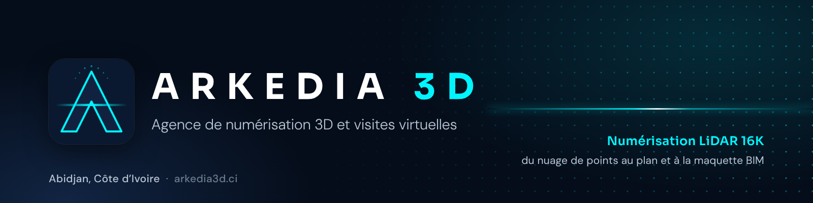

  

## La première agence de numérisation LiDAR 16K et de visites virtuelles en Côte d'Ivoire

ARKEDIA 3D relève les bâtiments au scanner LiDAR, à 2 cm près, à Abidjan et dans toute la Côte d'Ivoire. Un passage sur place suffit pour livrer ce dont ont besoin architectes, bureaux d'études et propriétaires :

- un nuage de points E57 et PLY colorisé ;
- des plans 2D en DWG et en PDF ;
- une maquette BIM LOD 200, précision LOA 20, en IFC 4, avec une copie IFC 2x3 que Revit ouvre ;
- un modèle SketchUp, sur devis ;
- une visite immersive 16K, à voir sur téléphone ou en casque VR.

## Nos outils libres

Nous publions ici les outils écrits pour notre propre production, sous licence libre.

| Outil | Ce qu'il fait |
|---|---|
| [Arkedia SKP Bridge](https://github.com/Arkedia3D/arkedia-skp-bridge) | Extension Blender qui importe et exporte les fichiers SketchUp (.skp) sans installer SketchUp. Une maquette IFC ouverte dans Bonsai devient un modèle SketchUp natif, rangé par niveau, avec ses attributs IFC. Licence GPL-3.0. |

## Voir une visite

[African Queen Lodge, Assinie](https://www.arkedia3d.ci/vr/african-queen-lodge?c=github)

## Nous écrire

contact@arkedia3d.ci · +225 07 00 34 28 26 · [arkedia3d.ci](https://www.arkedia3d.ci)

*Open-source tools for scan-to-CAD and scan-to-BIM workflows, made in Abidjan, Côte d'Ivoire.*
